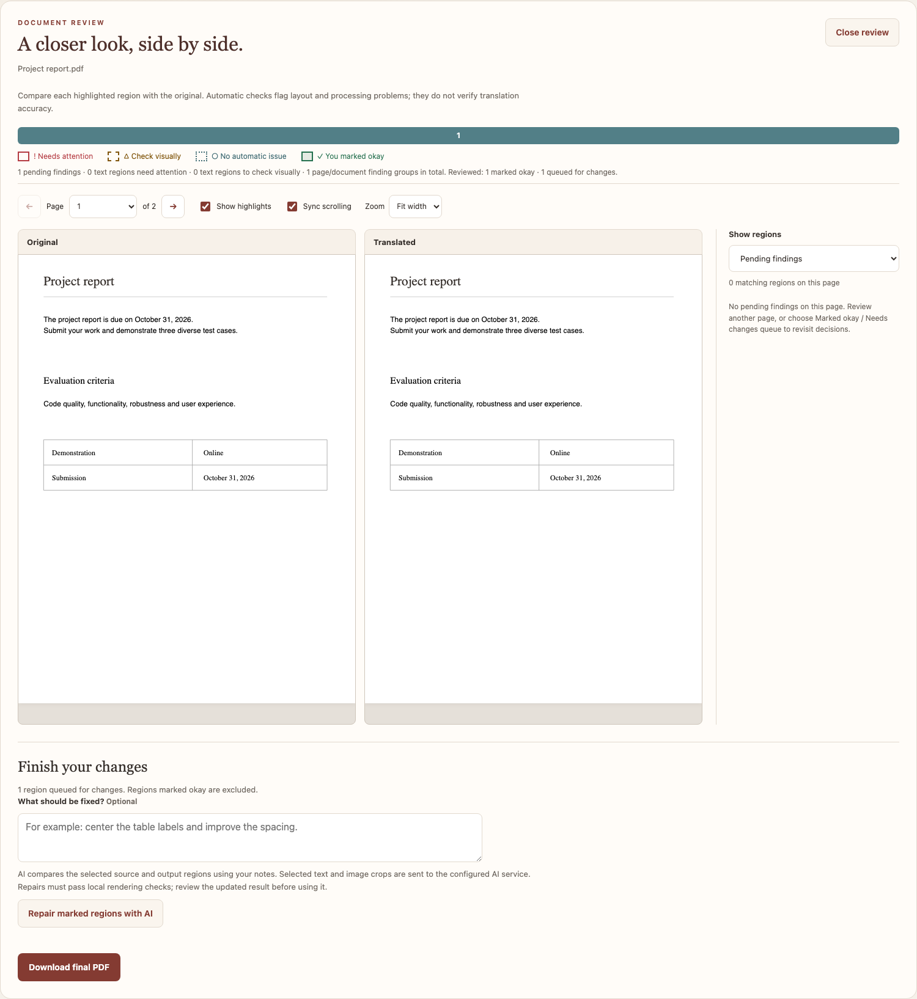
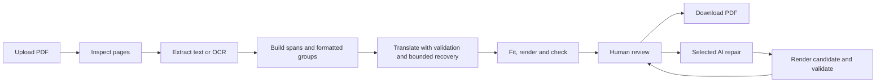

# Translation Studio

Translate digital and scanned PDFs into Indic languages, preserve their layout,
and review the result before exporting it. Translation Studio combines Bodhan
translation and OCR with local PDF processing, rendering checks, and optional
AI-assisted repair of regions selected by the reviewer.

Built by **Krishna Karthikeyan** with Python, FastAPI, PyMuPDF, SQLite, and a
browser interface served by the application. No separate frontend build is needed.



*Screenshot generated from synthetic browser-test documents; it illustrates the
review interface, not measured translation quality.*

## Features

- **Digital and scanned PDFs:** extract selectable text directly; use Bodhan OCR
  for image-only pages. Mixed PDFs use the appropriate path for each page.
- **Indic scripts and RTL text:** bundled Noto fonts, native language labels,
  script-aware shaping, and basic Urdu, Kashmiri and Sindhi RTL support.
- **Layout choices:** preserve original text boxes, reflow formatted paragraphs,
  or use the default automatic mode. Source continuation detection, measured
  paragraph flow, shared table-cell fitting and local
  typography passes improve spacing and size consistency where safe.
- **Formatting and literal protection:** retain inline styles and validate
  numbers, identifiers, URLs and translation markup before accepting responses.
- **Human review:** compare source/output previews, inspect highlighted findings,
  mark regions okay, and queue regions that need changes.
- **Selected AI repair:** provide optional notes, repair queued regions with a
  vision-capable model, inspect outcomes, and download the final or previous PDF.
- **Transliteration:** optionally convert eligible remaining English words into
  native-script pronunciations, either automatically or through preview/apply.
- **Persistent jobs:** SQLite-backed progress, revision history, bounded provider
  retries, cancellation, and recovery after connection interruptions.

## Quick start

### 1. Install

Use **Python 3.12 or newer**. Run all commands from the repository root.
Dependencies include PyMuPDF 1.28 or newer within the 1.x series; dependency installation needs internet
access. Live translation, OCR, transliteration and AI repair also need internet.

```sh
git clone https://github.com/DragonEolf/Translation_Studio.git
cd Translation_Studio
# Current submission implementation:
git switch codex/paragraph-inline-formatting
python3 -m venv .venv
source .venv/bin/activate
python -m pip install -e '.[test]'
cp .env.example .env
```

On Windows, activate with `.venv\Scripts\Activate.ps1` in PowerShell.

### 2. Configure credentials and fonts

Edit `.env` locally. Do not commit credentials.

| Setting | Purpose |
| --- | --- |
| `BODHAN_API_KEY` | Required for live translation; also used for transliteration. |
| `BODHAN_OCR_API_KEY` | Optional separate OCR key; otherwise OCR uses `BODHAN_API_KEY`. The selected key needs access to `indic-ocr`. |
| `STUDIO_FONT_DIR=./fonts` | Included in the example configuration; enables the bundled Indic fonts. |
| `OPENROUTER_API_KEY` | Used for selected-region AI repair and the optional phonetic transliteration fallback. |
| `STUDIO_TRANSLITERATION_MODEL` | Phonetic fallback model; defaults to `openai/gpt-4.1-mini`. Disable fallback with `STUDIO_TRANSLITERATION_FALLBACK_ENABLED=false`. |
| `STUDIO_REPAIR_MODEL` | Vision-capable OpenRouter model; defaults to `openai/gpt-4.1`. |

The repository includes fonts. If they are missing from your checkout, restore
them with `python -m scripts.download_fonts`, then restart the server.
Font licenses are included alongside the fonts, including
[`fonts/supported/LICENSE`](fonts/supported/LICENSE).

### 3. Run

```sh
python -m uvicorn app.main:create_app --factory --host 127.0.0.1 --port 8000
```

Open [Translation Studio](http://127.0.0.1:8000/),
[interactive API documentation](http://127.0.0.1:8000/docs), or
[service/font health](http://127.0.0.1:8000/v1/health).
The server starts without API keys, but live provider actions require credentials.

Use **one application process**: do not add `--workers` or run multiple servers
against the same data directory. `STUDIO_WORKERS` controls concurrent document
jobs within that process (default four); PDF operations are serialized because
PyMuPDF is not thread-safe.

## Using the app

1. Upload a PDF and choose the target language and layout mode. The default limits
   are 25 MB and 100 pages; encrypted PDFs are rejected.
2. Translate and inspect the rendered/retained-source summary. A partially
   translated document remains visibly flagged; a source-only result is a draft.
3. Open **See issues · compare PDFs**. Compare text, navigate pages, and inspect
   automatic findings alongside source/output highlights.
4. Mark regions **Looks okay** or **Needs changes**. Both leave the pending list;
   the latter enters the changes queue. Filters let you revisit either decision.
5. At the bottom of the review, optionally add repair notes and select
   **Repair marked regions with AI**. Only queued regions are submitted. Repairs
   must pass local checks; rejected candidates retain their prior content.
6. Review accepted repairs again, then use **Download final PDF**. After accepted
   repair, **Download previous PDF** retains the preceding output.

Review marks are scoped to the browser tab and output version. A changed output
invalidates earlier approvals; unsuccessful repair selections remain queued.
Simply opening the review or marking a region makes no model calls.

## How the agent workflow works



The orchestrator coordinates specialized processing agents. Extraction and layout
analysis choose the appropriate document path; the translator validates structure
and protected literals and retries or splits invalid/truncated passages within
bounded limits. Local checks inspect fitting, extracted content, collisions,
centering and graphics changes. The human decides which regions need AI repair.

The repair model receives selected source/output crops, text, findings, and
reviewer notes. It proposes constrained wording or layout changes. Application
code validates and renders proposals before publishing them, preserving revision
history and a previous-output backup. A locally rejected repair gets one additional
AI attempt with the rejected proposal, failure reason, and rendering findings.
Both attempts receive wider source/output crops, up to 12 nearby text blocks,
and up to 32 image/vector bounds as read-only context, with totals indicating
truncation. Local checks still consider all page obstacles. No-change/manual-review responses and provider failures are
not retried. This is a constrained document workflow;
models do not receive arbitrary filesystem or command access.

The [layout policy guide](docs/layout-policy.md) explains when regions may join,
when they stay anchored, how shaped text is measured, and how paragraph sizes
and available space are optimized.

## Codebase

```text
app/
  main.py                 FastAPI routes, validation and provider wiring
  config.py               Environment-backed settings
  orchestrator.py         Extraction, translation and rendering workflow
  agents/                 Inspection, OCR, text grouping, translation and checks
  providers/              Bodhan and selected AI repair API clients
  services/               Fitting, rendering, typography, review, jobs and storage
  models/                 SQLAlchemy models and SQLite integrity rules
  web/                    HTML, CSS, JavaScript and interface assets
  cli.py                  Repair/rerender an existing document from the command line
scripts/                  Font setup and documented manual diagnostics
tests/                    Python tests; mocked browser tests in tests/web/
benchmarks/               Offline layout suites, optional live evaluations and legacy experiments
docs/                     Interface image and detailed implementation notes
fonts/                    Bundled font files and third-party licenses
```

`data/` is created at runtime for PDFs, previews, SQLite and revisions. It is
ignored by Git, as are `.env`, `.venv/`, generated benchmark outputs and artifacts.

For the walkthrough, start with `main.py` → `orchestrator.py` → `agents/` →
`services/renderer.py` and `agents/checker.py`. Selected repair lives in
`providers/repair.py` and `services/ai_repair.py`; the review interface is
`web/review.js`.

## Verification

The [release verification record](docs/verification.md) documents the clean-install
checks and their limits.

```sh
python -m pytest -q
```

Python tests use temporary data and mocked providers. They do not make paid model
calls. Coverage includes digital/OCR processing, multilingual shaping, rich text,
literal protection, fitting, table layout, review snapshots, selected AI repair,
provider failures, cancellation and job recovery.

For browser tests, install Node.js and follow the
[browser verification guide](tests/web/README.md). These tests exercise the actual
HTML/CSS/JavaScript with mocked APIs, including responsive layout, review decisions,
repair recovery, and download controls. Screenshots go into the ignored `output/`
directory. Automated checks do not establish semantic translation quality.

### Development and evaluation

The [benchmark index](benchmarks/README.md) explains which suites to keep, what
each measures, and which commands use external services. These tools are separate
from the installed application. See the [development guide](docs/development.md)
for formatting, lint checks, architecture boundaries, and maintenance conventions,
and the [script index](scripts/README.md) for manual utilities.

Useful benchmark guides:

- [DocLayNet](benchmarks/doclaynet/README.md): reproducible offline layout checks.
- [Baseline stress suite](benchmarks/baseline/README.md): synthetic expansion and
  separately enabled live translation runs.
- [UGC English–Hindi](benchmarks/ugc/README.md): real-document translation and
  comparison with an official Hindi edition; requires your own input PDFs.

## Limitations and data handling

- Layout preservation is heuristic. Dense tables, complex formulas, rotated text,
  handwriting, low-quality scans and decorative layouts may need manual review.
- Scanned tables/equations can remain in their original image. OCR font styles and
  paper-background replacement are estimates; fine texture is not reconstructed.
- Translated text can shrink. Typography warnings are review prompts, not a
  guarantee of readability or correctness.
- RTL support shapes and aligns text; it does not mirror the entire page.
- Searchable Indic output uses shaped outlines with a block-level Unicode text
  layer; character-by-character selection may differ from native PDF text.
- AI repairs can fail, return no change, or be rejected. Passing local checks does
  not verify linguistic meaning. Review the output before using it.
- Processing files and revisions are stored locally. Translation text is sent to
  Bodhan; scanned page images are sent to its OCR service. Requested AI repair
  sends selected text and source/output image crops through OpenRouter. These
  external operations use your accounts and may incur charges. If Bodhan’s dedicated
  transliteration route returns 404, the configured OpenRouter fallback receives
  eligible English words or spoken letter names, without page images.
- The default server binds to localhost. It has no user authentication or tenant
  isolation and should not be exposed publicly as a hosted service without those
  controls.

See [implementation notes](docs/implementation.md) for API examples, rendering
rules, detailed recovery behavior, configuration and diagnostics.
