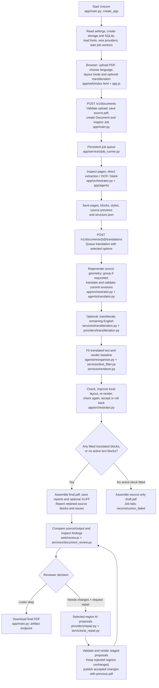
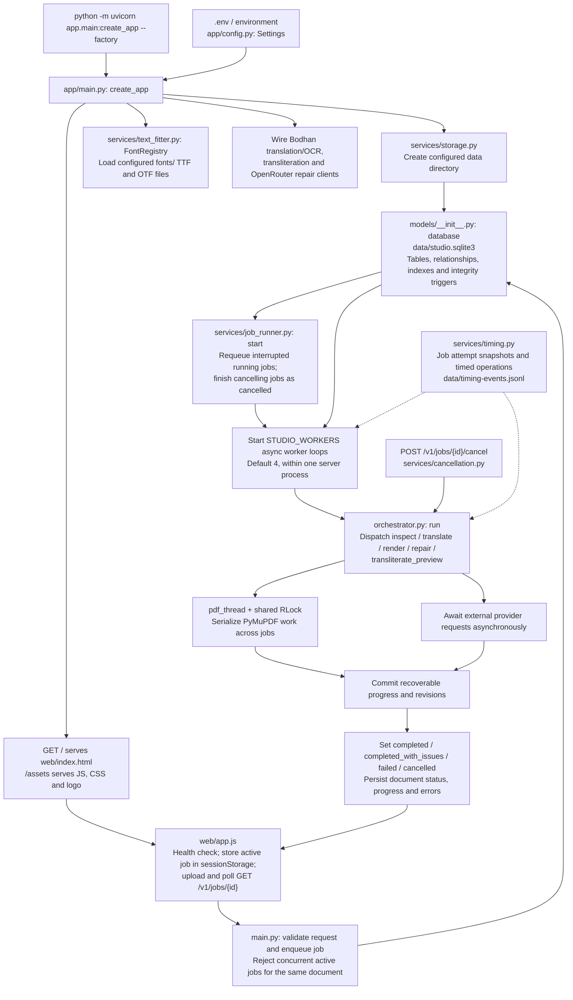
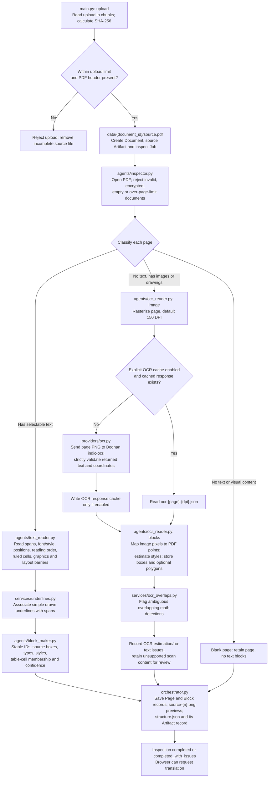
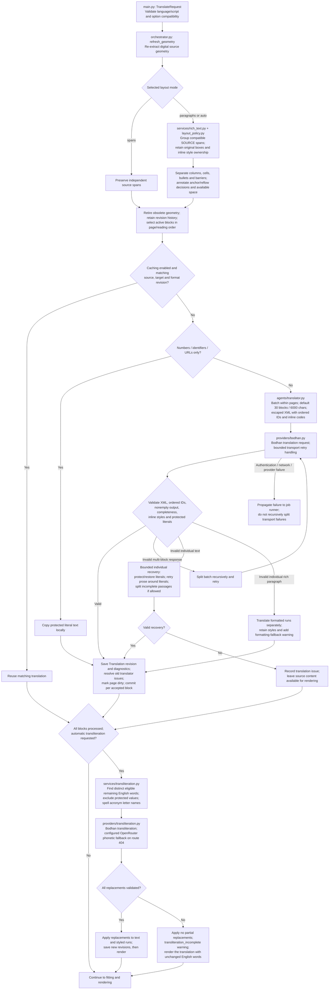
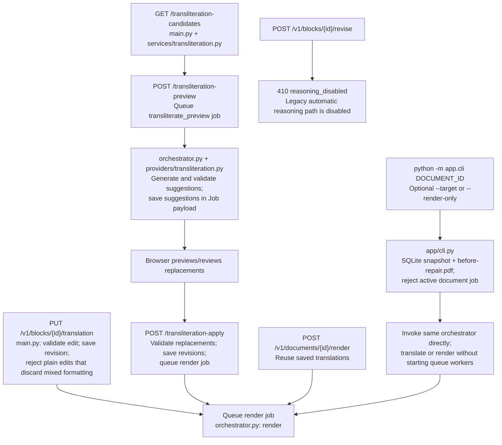

# Translation Studio — complete project flow

Verified against the current workspace implementation on 31 October 2026, including the local timing instrumentation. This describes the code as it currently works. File paths are relative to the repository root. Arrows show control/data flow; conditional paths are labelled. Each detailed chart expands part of the overview.

## 1. End-to-end overview



The named “agents” are Python classes with fixed responsibilities. Bodhan performs translation/OCR; OpenRouter is used for explicitly requested AI repair and the configured optional transliteration fallback. Local geometry, fitting, rendering and checking run in application code.

## 2. Startup, browser, jobs and persistence



API startup does not require working provider credentials. Live provider actions do. The browser's default layout is `auto`; the translation API model defaults to `spans`. Caching is disabled by default. With caching enabled, matching OCR results, translation revisions and clean pages can be reused.

## 3. Upload, inspection and extraction



Mixed documents choose the extraction route **per page**. A page that already has selectable text uses direct extraction; the application does not automatically OCR image regions embedded in that page. Scan tables/equations and suspected signatures may remain as original image content.

## 4. Source grouping, translation and optional transliteration



Invalid formatting/content and provider availability are different failure paths. Recovery is bounded; the split arrows do not mean unlimited retries. Structural validation protects formatting and literal values but does not verify linguistic meaning.

## 5. Exact rendering and local layout pass order

```mermaid
flowchart TD
    BEGIN["orchestrator.py: render<br/>Refresh digital geometry; iterate pages;<br/>reuse clean page only when caching is enabled"] --> SELECT["Load active blocks, matching translations,<br/>image/vector obstacles and OCR overlap flags"]
    SELECT --> FIT["agents/reorganiser.py<br/>Guard signatures, overlaps and unsupported content;<br/>resolve font/glyph support; measure fit"]
    FIT --> MEASURE["services/text_fitter.py + layout_tools.py<br/>Shape and measure actual plain/styled text;<br/>select fitting font size and optional condensed font;<br/>set fitted / overflow / unsupported / review status"]
    MEASURE --> BASE["services/renderer.py: render_page<br/>Copy original page; replace fitted regions only;<br/>retain all other source content"]
    BASE --> BGC["Digital: redact owned source text/decorations<br/>Scan: estimate local paper with scan_background.py<br/>OCR notation: ocr_notation.py"]
    BGC --> SHAPE["Render Latin as PDF text;<br/>complex scripts as shaped vector outlines<br/>plus searchable block ActualText layer"]
    SHAPE --> BEFORE["agents/checker.py + typography diagnostics<br/>Baseline text/literal, geometry, collision, clipping,<br/>centering and outside-region graphics checks"]
    BEFORE --> SNAP["Snapshot layouts and block styles"]
    SNAP --> CELL["1. services/cell_layout.py<br/>Shared scale and vertical flow within compatible cells"]
    CELL --> PARA["2. services/paragraph_flow.py<br/>Share safe space between nearby body paragraphs"]
    PARA --> COLUMN["3. services/column_flow.py<br/>Bounded joint selection of paragraph scales/heights"]
    COLUMN --> TYPE["4. services/typography.py, when enabled<br/>Smooth relative shrinkage with bounded refits"]
    TYPE --> ALIGN["5. services/table_alignment.py<br/>Restore supported source-centred table alignment"]
    ALIGN --> CHANGED{"Any changes proposed?"}
    CHANGED -->|No| PERSIST["Keep baseline; persist final issues,<br/>LayoutResult records and page outcomes"]
    CHANGED -->|Yes| RECHECK["Render changed page and run same checks again"]
    RECHECK --> SAFE{"No new per-block checker errors<br/>and every previously fitted block still fitted?"}
    SAFE -->|Yes| ACCEPT["Accept the combined local layout changes"]
    SAFE -->|No| ROLLBACK["Restore page's layout/style snapshots;<br/>render baseline again"]
    ACCEPT --> PERSIST
    ROLLBACK --> PERSIST
    PERSIST --> PAGE["Save page-{n}.pdf + page-{n}.png;<br/>mark page clean; commit; process next page"]
    PAGE --> EXPORT["Export translation.xlf for rich paragraphs;<br/>assemble pages in original page order;<br/>write layout-report.json"]
    EXPORT --> KIND{"At least one fitted translated block,<br/>or document has no active text blocks?"}
    KIND -->|Yes| FINAL["final.pdf<br/>completed or completed_with_issues"]
    KIND -->|No| DRAFT["Remove stale final.pdf; write draft.pdf<br/>reconstruction_failed for active source-only result"]
```



The local passes execute in the exact numbered order above. Their combined candidate is accepted or rolled back for that page. A fitted block with a checker finding is still reported as an issue; the checks are not a guarantee of correctness. Partial `final.pdf` output can contain retained source text, which is exposed in the translation summary. An empty document with no active text blocks can produce `final.pdf` without translated blocks.

## 6. Human review and selected-region AI repair

```mermaid
flowchart TD
    OPEN["web/review.js<br/>Open comparison workspace"] --> GET["GET /v1/documents/{id}/review<br/>services/document_review.py: review_snapshot"]
    GET --> SNAP["Versioned snapshot: source/output previews,<br/>PDF-coordinate regions, text and findings"]
    SNAP --> MARK["Reviewer marks Looks okay / Needs changes<br/>Store marks in browser sessionStorage,<br/>scoped to tab and output version"]
    MARK --> ACT{"Reviewer action"}
    ACT -->|Download| DL["main.py: artifact route<br/>Download current final.pdf or available previous.pdf"]
    ACT -->|Repair queued regions + optional notes| POST["POST /v1/documents/{id}/review/repair<br/>main.py: check version, region ownership, provider,<br/>region limit and idempotent request_id; enqueue"]
    POST --> JOB["job_runner.py → orchestrator.py<br/>services/ai_repair.py: repair_document"]
    JOB --> STAGE["Create isolated staging directory;<br/>load detached translations/layouts and page copies"]
    STAGE --> CONTEXT["Prepare selected source/output crops,<br/>source/target text, findings, reviewer notes,<br/>nearby text and graphics as read-only context"]
    CONTEXT --> MODEL["providers/repair.py: AIRepairProvider.suggest<br/>OpenRouter vision model; structured constrained proposal"]
    MODEL --> ACTION{"Proposal action"}
    ACTION -->|No change / manual review| UNCH["Record outcome; leave content unchanged"]
    ACTION -->|Repair| PROP["ai_repair.py: propose<br/>Validate text/runs/literals, fonts, size, bounds,<br/>selection constraints and local obstacles"]
    PROP --> VALID["Render candidate; CheckerAgent;<br/>validate content, collisions, clipping and graphics"]
    VALID --> PASS{"Pass local validation?"}
    PASS -->|Yes| ACCEPT["Keep candidate in staged page state"]
    PASS -->|No, first attempt| RETRY["One additional AI attempt with rejected proposal,<br/>rejection reason and rendering findings"]
    RETRY --> MODEL
    PASS -->|No, second attempt| UNCH
    MODEL -->|Provider unavailable| ABORT["Discard unpublished batch;<br/>preserve existing output and revisions"]
    ACCEPT --> NEXT["Process remaining selected regions"]
    UNCH --> NEXT
    NEXT --> ANY{"Any accepted repairs after all regions?"}
    ANY -->|No| SAME["Save outcomes in Job payload;<br/>publish no changed PDF"]
    ANY -->|Yes| PUBLISH["Assemble staged final.pdf;<br/>save previous.pdf and repair-report.json;<br/>update changed page PDFs/PNGs and optional XLIFF;<br/>save new translation revisions and layouts"]
    PUBLISH --> COMMIT["Publish files with rollback backups;<br/>commit DB; add review-again warnings"]
    COMMIT --> REOPEN["Reload review snapshot;<br/>changed output invalidates earlier marks;<br/>unsuccessful repair selections remain queued"]
    SAME --> REOPEN
    REOPEN --> SNAP
```



Opening review and marking regions make no model calls. Only a submitted repair request calls the repair model. No-change/manual-review outcomes and provider failures are not retried. A local proposal rejection receives at most one further AI attempt. Default repair limit: 20 regions. Crop context includes at most 12 nearby text blocks and 32 image/vector bounds; local obstacle checks still consider the full page.

## 7. Additional supported routes



The abbreviated transliteration URLs above are under `/v1/documents/{id}`. Selective transliteration applies replacements only after preview; normal rerendering does not call translation/OCR providers. The CLI's translate operation can call Bodhan. Its `--render-only` path uses saved translations.

## 8. Runtime output files and state

Paths below assume the default `STUDIO_DATA_DIR=./data`.

| File / state | Created or maintained by | Purpose / condition |
| --- | --- | --- |
| `data/studio.sqlite3` | `models/__init__.py`, API, worker, orchestrator | Documents, pages, source blocks, translation revisions, layouts, issues, jobs and artifact records. SQLite may also create journal/WAL sidecars. |
| `data/timing-events.jsonl` | `services/timing.py`, `job_runner.py`, providers, `pdf_thread` | Content-free timing events; job payloads also keep attempt timing snapshots. |
| `data/{id}/source.pdf` | `main.py: upload` | Original uploaded PDF. |
| `data/{id}/source-{n}.png` | `orchestrator.py: source_previews` | Source page previews. |
| `data/{id}/structure.json` | Inspection and geometry refresh in `orchestrator.py` | Page metadata, source geometry and blocks, including original span/style references. |
| `data/{id}/ocr-{n}-{dpi}.json` | Inspection in `orchestrator.py` | OCR response cache, only when caching is enabled. |
| `data/{id}/page-{n}.pdf` | `services/renderer.py`; accepted repair publication | Latest rendered page. |
| `data/{id}/page-{n}.png` | Same | Output page preview. |
| `data/{id}/final.pdf` | Orchestrator or accepted AI repair | Assembled output; can contain retained source content and review findings. |
| `data/{id}/draft.pdf` | Orchestrator | Source-only result when active blocks exist but none fit. A pre-existing draft can remain after a later successful run. |
| `data/{id}/translation.xlf` | `services/rich_text.py`, orchestrator, AI repair | XLIFF 2.2 text and inline-format references when rich translations exist. |
| `data/{id}/layout-report.json` | `orchestrator.py: render` | Baseline/candidate findings, attempted local passes, rollback/acceptance and block outcomes. Written by normal rendering; selected AI repair has its own report. |
| `data/{id}/previous.pdf` | `services/ai_repair.py` | Output preceding the latest accepted AI repair batch. |
| `data/{id}/repair-report.json` | `services/ai_repair.py` | Per-region repair outcomes when at least one repair is accepted; zero-accept outcomes remain in Job payload. |
| `data/{id}/repair-*/` | `services/ai_repair.py` | Temporary isolated page candidates, publication files and rollback backups; cleaned up after use. |
| `data/{id}/*.tmp.pdf` | `services/renderer.py: assemble` | Temporary assembly file atomically renamed to the destination. |
| `data/before-repair.sqlite3`, `data/{id}/before-repair.pdf` | `app/cli.py` | CLI backup snapshots, created if not already present. |
| Browser `sessionStorage` | `web/app.js`, `web/review.js` | Active document/job, reconnect information, versioned review marks and pending repair request. These review decisions are not database rows. |

## 9. Complete application file map

Every current application source/asset file is listed below. Package initializers provide import/package structure; `models/__init__.py` also contains the actual database implementation.

| File | Responsibility |
| --- | --- |
| [`app/__init__.py`](../app/__init__.py) | Package initializer; no processing stage. |
| [`app/agents/__init__.py`](../app/agents/__init__.py) | Package initializer; no processing stage. |
| [`app/agents/block_maker.py`](../app/agents/block_maker.py) | Classify extracted spans while retaining stable IDs, styles, and source geometry. |
| [`app/agents/checker.py`](../app/agents/checker.py) | Check rendered text, protected values, geometry, and changes outside replaced regions. |
| [`app/agents/inspector.py`](../app/agents/inspector.py) | Validate PDF inputs and choose digital, scanned, or blank-page extraction. |
| [`app/agents/ocr_reader.py`](../app/agents/ocr_reader.py) | Validate OCR responses and map pixel coordinates to PDF document regions. |
| [`app/agents/reorganiser.py`](../app/agents/reorganiser.py) | Choose supported fonts and fit translations while retaining unsafe source regions. |
| [`app/agents/text_reader.py`](../app/agents/text_reader.py) | Extract selectable text, table cells, decorations, and layout barriers. |
| [`app/agents/translator.py`](../app/agents/translator.py) | Translate validated XML batches with protected literals and bounded passage recovery. |
| [`app/cli.py`](../app/cli.py) | Run or resume an existing document without launching a second queue worker. |
| [`app/config.py`](../app/config.py) | Environment-backed application settings and structured service errors. |
| [`app/main.py`](../app/main.py) | FastAPI application factory, request validation, and job submission endpoints. |
| [`app/models/__init__.py`](../app/models/__init__.py) | Persistent document state and additive SQLite integrity migrations. |
| [`app/orchestrator.py`](../app/orchestrator.py) | Coordinate extraction, validated translation, rendering, and recovery. |
| [`app/providers/__init__.py`](../app/providers/__init__.py) | Package initializer; no processing stage. |
| [`app/providers/bodhan.py`](../app/providers/bodhan.py) | Bodhan translation client, supported targets, and bounded transport retries. |
| [`app/providers/ocr.py`](../app/providers/ocr.py) | Bodhan OCR client and strict validation of text and page-image coordinates. |
| [`app/providers/repair.py`](../app/providers/repair.py) | User-requested multimodal repair proposals, never arbitrary model actions. |
| [`app/providers/transliteration.py`](../app/providers/transliteration.py) | Bodhan transliteration uses the existing Bodhan bearer key. |
| [`app/services/__init__.py`](../app/services/__init__.py) | Package initializer; no processing stage. |
| [`app/services/ai_repair.py`](../app/services/ai_repair.py) | Selected-region repair: stage candidates, check them, then publish with backup. |
| [`app/services/cancellation.py`](../app/services/cancellation.py) | Cooperative cancellation across HTTP awaits and PDF worker threads. |
| [`app/services/cell_layout.py`](../app/services/cell_layout.py) | Shared typography and vertical flow for related paragraphs in table cells. |
| [`app/services/column_flow.py`](../app/services/column_flow.py) | Bounded dynamic programming for compatible paragraph layout candidates. |
| [`app/services/document_review.py`](../app/services/document_review.py) | Read-only review snapshots: PDF coordinates match the rotated page previews. |
| [`app/services/job_runner.py`](../app/services/job_runner.py) | Single-process asynchronous job queue with restart recovery and cancellation. |
| [`app/services/layout_policy.py`](../app/services/layout_policy.py) | Deterministic source-layout policy: confident continuation, otherwise anchoring. |
| [`app/services/layout_tools.py`](../app/services/layout_tools.py) | Shared exact layout measurement for fitting, repairs and final rendering. |
| [`app/services/ocr_notation.py`](../app/services/ocr_notation.py) | Convert supported OCR math notation without altering currency or source data. |
| [`app/services/ocr_overlaps.py`](../app/services/ocr_overlaps.py) | Identify ambiguous small math detections overlapping a larger OCR passage. |
| [`app/services/paragraph_flow.py`](../app/services/paragraph_flow.py) | Share geometry between nearby body paragraphs without combining translations. |
| [`app/services/renderer.py`](../app/services/renderer.py) | Render validated text replacements and assemble pages into an output PDF. |
| [`app/services/rich_text.py`](../app/services/rich_text.py) | Paragraph geometry, local styles, and XLIFF 2.2 interchange. |
| [`app/services/scan_background.py`](../app/services/scan_background.py) | Estimate replacement paper from the unmodified scan, never from prior fills. |
| [`app/services/storage.py`](../app/services/storage.py) | Local per-document paths and UTF-8 JSON artifact persistence. |
| [`app/services/table_alignment.py`](../app/services/table_alignment.py) | Preserve source-centred table cells using measured, shaped text geometry. |
| [`app/services/text_fitter.py`](../app/services/text_fitter.py) | Resolve script fonts and measure shaped plain or styled text against PDF bounds. |
| [`app/services/timing.py`](../app/services/timing.py) | Content-free job timing with UTC timestamps and monotonic durations. |
| [`app/services/transliteration.py`](../app/services/transliteration.py) | Conservative opt-in replacements in existing translated text and rich runs. |
| [`app/services/typography.py`](../app/services/typography.py) | Bounded local smoothing of relative font scales, never global minimum sizing. |
| [`app/services/underlines.py`](../app/services/underlines.py) | Associate simple PDF underline paths with their owning text spans. |
| [`app/web/app.js`](../app/web/app.js) | Health check, upload/translation jobs, polling/reconnect/cancellation, downloads and selective transliteration. |
| [`app/web/iitm-logo.png`](../app/web/iitm-logo.png) | IIT Madras branding displayed by the interface. |
| [`app/web/index.html`](../app/web/index.html) | Browser page structure, upload/options form, progress, result and review controls. |
| [`app/web/review.css`](../app/web/review.css) | Comparison workspace styling and responsive behavior. |
| [`app/web/review.js`](../app/web/review.js) | Comparison workspace, region selection, versioned review marks, repair submission/reconnect and outcomes. |
| [`app/web/style.css`](../app/web/style.css) | Main interface appearance and responsive layout. |

## 10. Supporting project files

These files support installation, documentation, testing and evaluation; they are separate from the runtime upload-to-download flow.

| Path | Role |
| --- | --- |
| `pyproject.toml` | Package/dependency declaration, Python requirement, test and Ruff configuration; installed package contains `app/`. |
| `.env.example` | Documented environment settings; local `.env` supplies credentials and overrides. |
| `.gitignore` | Keeps secrets, environments and generated working data out of Git. |
| `README.md` | Installation, operation, architecture overview and limitations. |
| `CHECKPOINTS.md` | Development checkpoint notes. |
| `docs/implementation.md` | Detailed API/rendering/recovery behavior. |
| `docs/layout-policy.md` | Source grouping, anchoring and reflow policy. |
| `docs/development.md` | Maintenance and architecture conventions. |
| `docs/verification.md` | Release verification evidence and limits. |
| `docs/images/review-workspace.png` | README review UI screenshot. |
| `docs/images/initial-ui.png` | README initial upload UI screenshot. |
| `docs/code-walkthrough-notes.md` | One-line notes for application and supporting files. |
| `TEST EXAMPLES/` | 22 original/output pairs, source-only draft labels, and measured timing reports. |
| `docs/project-flowchart.md` | This implementation flow and file map. |
| `fonts/` | Bundled Noto font files, manifests and third-party licenses; loaded through `FontRegistry`. |
| `scripts/` | Font setup, manual diagnostics and retained experiments; see file inventory below and `scripts/README.md`. |
| `tests/` | Python regressions and mocked browser tests; providers are mocked rather than called live. |
| `benchmarks/` | DocLayNet, baseline, UGC, OpenRouter, ForMaT and historical repair suites; not invoked by the installed application. |
| `output/`, `artifacts/` | Generated diagnostics/evaluation artifacts; contents depend on local runs. |
| `.venv/`, `translation_studio.egg-info/`, `__pycache__/`, `.pytest_cache/`, `.idea/` | Local environment, package metadata, caches and IDE files; not pipeline stages. |

### Supporting source inventory

<details>
<summary>scripts/ — 15 source, guide and fixture files</summary>

```text
scripts/README.md
scripts/audit_layout_policy.py
scripts/check_all_languages.py
scripts/compare_scan_backgrounds.py
scripts/download_fonts.py
scripts/inline_layout_experiment.py
scripts/render_html_pair.cjs
scripts/render_inline_results.py
scripts/render_sparse_inline_results.py
scripts/retry_resume_paragraph_test.py
scripts/test_bodhan_delimiters.py
scripts/test_paragraph_pipeline.py
scripts/test_resume_cell_layout.py
scripts/test_resume_paragraph_live.py
scripts/test_sparse_inline.py
```

</details>

<details>
<summary>tests/ — 42 source, guide and fixture files</summary>

```text
tests/fixtures/ocr_novelty.json
tests/test_ai_repair.py
tests/test_auto_layout.py
tests/test_batching.py
tests/test_cancellation.py
tests/test_cell_layout.py
tests/test_column_flow.py
tests/test_doclaynet_benchmark.py
tests/test_doclaynet_boxes.py
tests/test_doclaynet_regressions.py
tests/test_document_review.py
tests/test_downloads.py
tests/test_font_fallback.py
tests/test_format_pilot.py
tests/test_inline_layout_experiment.py
tests/test_interface_api.py
tests/test_layout_policy.py
tests/test_manual_utilities.py
tests/test_ocr.py
tests/test_ocr_fitting.py
tests/test_ocr_notation.py
tests/test_ocr_overlaps.py
tests/test_openrouter_benchmark.py
tests/test_parallel_jobs.py
tests/test_priority_workflow.py
tests/test_reconstruction.py
tests/test_rich_text.py
tests/test_rtl.py
tests/test_scan_background.py
tests/test_span_alignment.py
tests/test_studio.py
tests/test_table_alignment.py
tests/test_timing.py
tests/test_translation_recovery.py
tests/test_transliteration.py
tests/test_typography.py
tests/test_ugc_benchmark.py
tests/test_underlines.py
tests/test_vision_pipeline.py
tests/test_vision_review.py
tests/web/README.md
tests/web/studio.spec.cjs
```

</details>

<details>
<summary>benchmarks/ — 43 source, guide and fixture files</summary>

```text
benchmarks/README.md
benchmarks/__init__.py
benchmarks/baseline/README.md
benchmarks/baseline/__init__.py
benchmarks/baseline/analyze_live.py
benchmarks/baseline/live.py
benchmarks/baseline/run.py
benchmarks/doclaynet/BOX_FINDINGS.md
benchmarks/doclaynet/FINDINGS.md
benchmarks/doclaynet/README.md
benchmarks/doclaynet/__init__.py
benchmarks/doclaynet/audit.py
benchmarks/doclaynet/boxes.py
benchmarks/doclaynet/compare.py
benchmarks/doclaynet/manifest.json
benchmarks/doclaynet/prepare.py
benchmarks/doclaynet/run.py
benchmarks/format/README.md
benchmarks/format/balanced.py
benchmarks/format/pilot.py
benchmarks/format/prepare.py
benchmarks/legacy/README.md
benchmarks/legacy/__init__.py
benchmarks/legacy/reasoning.py
benchmarks/legacy/settings.py
benchmarks/legacy/vision.py
benchmarks/legacy/vision_repair.py
benchmarks/openrouter/README.md
benchmarks/openrouter/__init__.py
benchmarks/openrouter/cases.py
benchmarks/openrouter/client.py
benchmarks/openrouter/compare.py
benchmarks/openrouter/generate.py
benchmarks/openrouter/html_renderer.py
benchmarks/openrouter/prompts.py
benchmarks/openrouter/render.py
benchmarks/openrouter/rubric.json
benchmarks/openrouter/run.py
benchmarks/ugc/README.md
benchmarks/ugc/__init__.py
benchmarks/ugc/diagnostics.py
benchmarks/ugc/rubric.json
benchmarks/ugc/run.py
```

</details>

## 11. Accuracy and verification boundaries

This is a static code walkthrough, checked against the current source and route definitions. No live translation, OCR, repair calls or document modifications were made to establish the chart. Fitting/checking can detect structural and rendering problems; final translation meaning and appearance still require human review. Existing local source changes were preserved.
